## About

Hi, I'm Varshini, a student at Dayananda Sagar University in Bangalore. I build and learn in public, and this profile collects my work.

<!-- TODO: add 1-2 sentences about your branch/year and what you're focused on. -->

## Achievements

<!-- TODO: add only achievements and certifications you can verify, with a link to the certificate where possible. -->
_Coming soon._

## Projects

## Projects

| Project | What it is |
| --- | --- |
| [Heart-Disease-Prediction](https://github.com/Varshini-0007/Heart-Disease-Prediction) | Heart disease prediction built in Python |
| [JobGuard_AI](https://github.com/Varshini-0007/JobGuard_AI) | AI project built in Python |
| [speech-assistant](https://github.com/Varshini-0007/speech-assistant) | Speech assistant project |
| [Studyhub](https://github.com/Varshini-0007/Studyhub) | Study platform project |

[See all my repositories](https://github.com/Varshini-0007?tab=repositories)

## Skills

## Tech Stack

  
  
  
  
  
  
  

  
  
  
  

  
  
  
  
  

  
  
  
  

<!-- TODO: confirm these and add CSS, Python, frameworks, databases, tools you actually use. -->

## GitHub stats

  
  

## Connect

<!-- TODO: add LinkedIn / LeetCode / portfolio links. Do not add a phone number. -->

  
  
  
  

